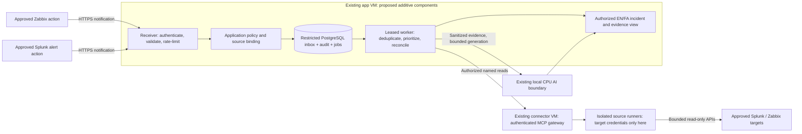

# Active monitoring with Splunk and Zabbix webhooks

[فارسی](../fa/ACTIVE_MONITORING_WEBHOOKS.md) · [Index](INDEX.md) · [Requirements and gates](../requirements/ACTIVE_MONITORING_WEBHOOK_SPEC.md)

Version: **0.1, proposed design and team handoff, 2026-10-31**.

**Not implemented or deployed.** This document authorizes no server access, firewall change,
Splunk/Zabbix configuration, database migration, model change or notification delivery. Every path,
payload, limit and command below is a proposed contract or sanitized example, not a working endpoint.
Existing release identities and acceptance results remain in the [release manifest](../status/current-release.yaml).

## 1. Outcome and boundaries

Receive approved infrastructure alerts without an operator asking a question, preserve them durably,
collect bounded supporting evidence, and produce an auditable English/Persian incident summary.
Show what happened, when, on which permitted target, what is verified, what remains a hypothesis,
what evidence is missing, and which safe diagnostic checks an operator can perform next.

This is **near-real-time event-driven investigation**, not guaranteed real-time processing or a
replacement SIEM. Splunk remains the log store/search system; Zabbix remains the monitoring system.
Zabbix problems, events and metrics are not a feed of every server log. Reading log-item content
requires that it exists in the source and that the operation is separately supported and approved.

Out of scope: bulk log replication, unrestricted SPL, arbitrary URLs/commands, automatic remediation,
acknowledging/closing source problems, changing alerts, training the model from incoming logs,
new model selection, a new VM, mandatory Redis/Kafka, SMTP, voice calling, or cloud AI.

## 2. Current capability versus proposed work

| Area | Repository baseline | This proposed increment |
|---|---|---|
| Collection | User-requested, scoped Zabbix/Linux evidence through canonical MCP | Source-driven notification plus bounded reconciliation |
| Splunk | No qualified Splunk adapter or active integration | Version-qualified read-only adapter and approved source binding |
| Ingestion | No active-monitoring webhook receiver | Authenticated source-specific receiver |
| Persistence | Existing restricted PostgreSQL investigations/audit | Additive inbox, delivery history, jobs and source cursors |
| Execution | Bounded local CPU inference; no general active-event worker | Separately supervised, bounded event worker |
| Operator UI | Existing investigation/evidence views | Permission-filtered event feed and incident lifecycle |
| Delivery | No new notification channel qualified by this design | Local panel first; any additional channel separately qualified |

Read the [architecture](ARCHITECTURE.md), [MCP boundary](MCP.md), [security guide](SECURITY.md),
[offline contract](OFFLINE_RUNTIME.md) and [data/API guide](DATA_API.md) before implementation.
This publication does not synchronize unrelated unmerged source branches or redefine a live release.

## 3. Architecture and placement

**Proposed, not deployed:** reuse the existing app, AI and connector VMs. The public-to-operators
application stays on the app VM. Put the source-facing webhook route behind its existing internal
HTTPS reverse proxy; do not expose the loopback MCP listener or make the AI VM an ingress endpoint.
Opening any new source-to-app flow requires the network owner's approval.



The webhook reports an event. MCP obtains corroborating evidence. Application policy authorizes
both publication and collection; neither a webhook, tool annotation nor model output grants access.
Target tokens remain runner-only. An upstream Splunk MCP service, if selected, is reached through
a reviewed isolated client/runner; it is not added directly to the model's tool list.

## 4. Network handoff

| Initiator | Destination | Purpose | Rule |
|---|---|---|---|
| Approved Zabbix notification process | App HTTPS ingress | Problem/update/recovery notifications | Exact source address, destination and approved port |
| Approved Splunk search-head/alert process | App HTTPS ingress | Selected alert notifications | Exact egress/NAT identity, destination and approved port |
| App worker | Existing MCP gateway via protected tunnel | Evidence request | Preserve authenticated TLS and existing trust boundary |
| Isolated connector runner | Approved Zabbix HTTPS API | Supporting reads/reconciliation | Exact endpoint and scoped source credentials |
| Isolated Splunk runner | Approved search-head API or vendor MCP endpoint | Supporting searches | Version-specific endpoint; never HEC ingestion |
| App worker | Protected local AI boundary | Evidence synthesis | Existing local-only route, authentication and admission |

HTTPS port 443 at ingress and Splunk management port 8089 are conventional examples, not an approved
network rule. The actual FQDN, port, certificate chain, proxy/NAT and firewall owners belong in the
private handoff. Splunk Cloud cannot meet a WAN-independent source requirement; classify it explicitly
as an optional WAN-dependent source rather than weakening NextOps's local operating contract.

## 5. Information to obtain from the source teams

| Owner | Required deliverable |
|---|---|
| Splunk team | Enterprise/Cloud, exact platform and app versions, search-head/API endpoint, optional official MCP version/endpoint, authentication options, retry behavior, approved indexes/hosts/sourcetypes, alert definitions, event identifiers, retention and indexing delay |
| Zabbix team | Exact version, logical primary/secondary source mapping, approved hosts/groups, problem/update/recovery mapping, media/action owner, observed retry policy and API access scope |
| Security/data owner | Source identities, organization/environment mapping, permitted recipients, masking rules for personal/banking data, retention, certificate trust and credential rotation/revocation |
| Network/PKI team | Approved directional flows, source egress/NAT identity, internal DNS/time, trusted certificate chain, renewal and offline trust behavior |
| NextOps team | Private receiver configuration, adapter version, database migration/roles, source registry, queue limits, policy, worker, UI, tests and rollback owner |
| Operations owner | Test window, escalation owner, acceptable latency/backlog, outage tolerance, backfill horizon and explicit sign-off |

Never request administrator/root access to Splunk/Zabbix just to read evidence. Deliver credentials
through the approved protected channel, not chat, ordinary email, Git, screenshots or request URLs.
An API search token, an HEC token and an encrypted vendor MCP token are different credentials.

## 6. Source profiles and authentication

Use a separate reviewed integration identity and secret reference per source; never reuse a browser
session, the MCP service bearer, or a target API token to authenticate inbound webhook messages.
Bind organization/environment, allowed targets and allowed event classes in protected configuration,
not fields chosen by the sender. Recheck current policy when work starts and when results are shown.

Possible ingress mechanisms are mTLS or a supported authenticated publisher with signed requests
or a protected authorization header. Choose and test **one exact profile per installed version**.
Network allowlisting is defense in depth, not sufficient source authentication by itself.

For a reviewed HMAC profile, define key ID, signed timestamp, delivery ID and signature headers;
sign the timestamp, delivery ID and SHA-256 of the exact request bytes using HMAC-SHA-256. Specify
byte encoding and signature encoding, compare in constant time, reject unknown keys and use a
bounded replay window/store. The initial timestamp window proposed here is 300 seconds. Legitimate
delayed retries must be freshly signed or use a separately reviewed replay-safe profile. An old
event timestamp is not an old request signature. Support overlapping keys during controlled rotation.

**Splunk compatibility stop:** the built-in Webhook action's documented URL/JSON capability is not
proof of arbitrary authorization headers, HMAC or client-certificate support. The source team must
demonstrate the selected authentication mechanism. If unavailable, use an approved authenticated
custom alert action, or a relay whose *upstream* authentication is also verified, or read-only polling.
A relay adding a header to an unauthenticated upstream message does not establish source identity.
Do not fall back to a token in a URL, disabled TLS verification or IP-only trust to pass a test.

All ingress must validate content type, body bytes, JSON depth/types, field lengths and event classes;
reject redirects, decompression surprises and URLs/commands outside the schema. Host/event text is
untrusted data. Never fetch a supplied `results_link`, file path or callback URL; resolve a reviewed
source endpoint and authorized event identity through the registry instead.

## 7. Proposed HTTP contract

These paths do not exist yet:

```text
POST /api/v1/webhooks/zabbix/{integration_id}
POST /api/v1/webhooks/splunk/{integration_id}
```

`integration_id` is an opaque configured binding, not a secret or an authorization grant. Each route
uses its own native adapter and authentication profile. Do not weaken existing user APIs or reuse
the MCP route for public ingress. Configure source URLs in a private change record only after
endpoint availability and authentication have been qualified.

| Response | Proposed meaning | Sender/operator handling |
|---|---|---|
| `202` | Inbox record, intent audit and durable work item committed | Processing is pending, not a verified incident or completed analysis |
| `200` | Verified duplicate of an already committed delivery | Return the prior opaque receipt; do not schedule a second analysis |
| `400` / `415` / `422` | Invalid envelope, unsupported media type or invalid fields | Correct configuration; do not retry unchanged forever |
| `401` / `403` | Missing/invalid identity or denied binding | Investigate through a separate channel; no fallback identity |
| `404` | Unknown route/integration | Generic response without inventory details |
| `409` | Authenticated delivery identity reused with conflicting content | Hold the conflict for review; do not overwrite the original |
| `413` | Body exceeds the configured bound | Reduce payload; do not truncate into a successful message |
| `429` | Admission/rate/backlog limit reached | Bounded retry only if supported; honor tested `Retry-After` behavior |
| `503` | Required audit/storage/queue unavailable | Never acknowledge an uncommitted event; reconcile delivery later |

Responses contain an opaque receipt and request correlation ID only, not private inventory, keys,
raw event text or exception traces. Invalid/denied deliveries have bounded, sanitized local security
records; source-system logs remain necessary if NextOps cannot persist anything.
The installed sender must be proven to accept the agreed success codes, including `202` and the
duplicate response; a script that accepts only `200` must be adapted and reviewed before activation.

## 8. Native payloads and canonical event

Splunk's documented native payload includes search identity/context and the first result row;
it does **not** contain every matching log. Scope and fetch additional rows using an approved search
identity/template and bounded time interval. The existing source team must approve both the rule
and its interpretation; alert severity and apparent correlation do not prove incident cause.

For Zabbix, select problem/update/recovery fields explicitly and retain both the original problem
identifier and any recovery/update identifier. A media-type test is not proof that a real action,
recipient severity/schedule, recovery path or retry policy works.

The adapter, not the upstream sender, creates this proposed internal representation:

```json
{
  "schema_version": "1.0",
  "delivery_id": "demo-delivery-001",
  "source_id": "demo-zabbix-primary",
  "source_event_id": "demo-problem-1001",
  "source_revision": "problem:1",
  "event_type": "problem",
  "target_id": "demo-app-01",
  "severity": "high",
  "title": "Illustrative service alert",
  "observed_at": "2026-10-31T10:00:00Z",
  "received_at": "2026-10-31T10:00:02Z",
  "correlation_id": "8bad8cfa-4ff9-4e2d-83cf-e9d23caec100",
  "provenance": "authenticated_source_notification",
  "evidence_status": "not_collected"
}
```

**Demo only, not live data or a vendor-native payload.** `source_id`, `target_id` and permitted scope
are deployment-resolved; `received_at` and correlation are server-owned. Keep source time, receive
time and later evidence collection time distinct, UTC in storage and locale-aware in the UI.
Versioned schemas must reject unknown security-relevant fields. Missing or ambiguous target mappings
are quarantined without an MCP call, dynamic enrollment or privileged fallback.

The implementation schema must freeze at least these constraints before enabling a source:

| Field | Proposed constraint |
|---|---|
| `schema_version` | Exact supported version; reject unknown major versions |
| `delivery_id`, `source_event_id`, `source_revision` | Nonempty bounded strings, at most 128 characters each; version-specific stable mapping |
| `source_id`, `target_id` | Existing protected registry identifiers; never caller-created endpoints |
| `event_type` | Closed `problem`, `update`, `recovery` set with explicit adapter mapping |
| `severity` | Closed `unknown`, `info`, `warning`, `average`, `high`, `critical` set; source mapping is versioned |
| `title` | At most 512 characters; no HTML interpretation; no credential content |
| `observed_at`, `received_at` | Timezone-aware timestamps; server owns receive time; invalid source time is explicit |
| `correlation_id` | Server-generated UUID; not trusted as a user or scope identity |
| `provenance`, `evidence_status` | Server-owned notification/evidence classification, not a sender's verified-health claim |

Keep the raw-byte signature digest separate from the normalized source-event digest used for
deduplication. Exclude server-generated receive time, receipt and correlation from the latter;
otherwise a legitimate retry would conflict with its first delivery. Define the deduplication
retention horizon against maximum retry/backfill age; purging a key must not let an expired event
silently reopen a resolved incident. Authentication failure must not allocate unbounded per-ID counters.

## 9. Durable inbox, audit and worker

Use an additive reviewed migration in the existing restricted NextOps PostgreSQL. Do not create a
new database guest or introduce a broker by default. Proposed logical records are integrations,
deliveries/inbox events, analysis jobs, cursor checkpoints, incident links and audit references.
They are a design, not existing table names. Specify indexes, uniqueness and service-role grants
in the implementation migration; runtime roles cannot administer the database or alter audit history.

A committed inbox survives the tested process restart; it is not host-loss high availability or an
independent backup. The existing VMs share the same hypervisor/storage failure domain. Required
database-aware recovery remains a separate, explicitly evidenced project gate.

In one transaction commit the validated inbox record, required intent audit and work item/outbox.
Only then send success. A worker claims a finite lease, heartbeats while it owns work, and marks
terminal state with evidence hashes and audit references. Restart must recover committed work;
lease expiry must not permit a second native model/connector call while the original still runs.
Use owned execution IDs, drain/reconcile uncertain calls and preserve bounded admission on cancellation.

This is retryable processing with deduplication, **not exactly-once delivery/execution**. Persist the
attempt count and next attempt time. Retry only classified transient failures with bounded backoff
and jitter; authentication/policy/schema failures are held for operator action. Stop after a finite
attempt count and keep an inspectable dead-letter/held state. Required audit failure blocks publication.

## 10. Identity, duplication and incident lifecycle

Distinguish three identities:

- Delivery identity: replay or retry of the same message. Deduplicate within integration identity.
- Source event/revision: a notification about a particular problem or search result state.
- Incident/correlation identity: related authorized observations grouped for an operator.

Use organization, environment and source in every deduplication key. A source revision may be an
upstream identifier or a reviewed adapter fingerprint; never deduplicate solely by title or host.
A reused delivery ID with a different authenticated payload digest is a conflict/security event,
not an accepted duplicate. Splunk SID identifies a search execution, not necessarily one ongoing
incident; the adapter must define a stable result key separately. Store the adapter/policy version.

Proposed states: `received`, `validated`, `queued`, `collecting`, `analyzing`, `completed`, `partial`,
`held`, `failed`, `resolved`. Keep delivery, analysis and source-problem state separate. A recovery
notification can resolve a source problem before analysis finishes. A late older problem must not
reopen it silently. Prefer source revision/sequence where available; ambiguous clock/order cases
stay explicit. Recovery without a known problem is retained and reconciled, not discarded.

## 11. Reconciliation and gaps

Webhook delivery can be lost, duplicated or delayed. Actual retries depend on the installed sender;
do not assume Splunk or Zabbix retries indefinitely or honors every HTTP status identically.
The source team must document measured timeout, attempts, retry interval and retention.

Maintain an independent authorized reconciliation cursor per source. Proposed initial interval:
60 seconds, subject to source approval. Use overlapping bounded windows, event-ID tie breakers and
deduplication to handle late indexing and clock skew. Advance a durable cursor only after the fetched
page has committed. A truncated response, timeout or partial page must not advance it beyond data
actually persisted. Expired source retention or inaccessible search results become a visible gap,
not a claim that all events were recovered. Reconcile source recovery states as well as new problems.

## 12. Enrichment and AI behavior

Bind background work to a dedicated restricted integration principal and subscription, not a made-up
interactive user session. Explicitly authorize organization, environment, target, operation and index
scope before collecting. Recheck after revocation and immediately before publication. Filter every
operator's incident/evidence view using their own current permissions, even if a service collected it.

Use named fixed Zabbix reads and version-qualified Splunk search templates/saved searches with typed
parameters, time bounds, allowed indexes/hosts and output caps. No arbitrary SPL from the model,
wildcard index access, mutating commands, source acknowledgments or alert reconfiguration. Native
search-job creation can be necessary to perform a read; its lifecycle must be restricted to the
integration's own jobs and must not grant general source administration.

Redact secrets and restricted personal/banking fields before persistence and before the model.
If raw retention is required, it needs a separate approved access/encryption/expiry design; it is
not enabled by this proposal. Hashes support integrity/provenance, not anonymization or deletion.
Model inputs use sanitized evidence, never source tokens or hidden connector configuration.

The local CPU model distinguishes reported alert, independently retrieved observation, hypothesis
and suggested check. It cites actual source/time/scope, marks stale/partial/missing evidence and
never fills a failed source from another source silently. A failed generation does not erase an
alert: show recorded source facts with `analysis unavailable`, not a fabricated AI answer.
Existing general Q&A must remain usable when its own dependencies are healthy.

## 13. Proposed starting limits, not measurements

| Control | Initial candidate | Acceptance obligation |
|---|---|---|
| Ingress body | 64 KiB, no compressed request bodies | Enforce while reading, before unbounded allocation |
| Ingress rate | 30 deliveries/minute/integration, burst 10 | Shared bounded counters; exact aggregation semantics tested |
| Unfinished backlog | 1,000 events globally, 100 per integration | Atomic admission; reject before commitment when full |
| Retained canonical text | Title 512 characters; message 4,096 characters | Explicit size/partial state; never silently claim a complete log |
| Splunk enrichment | Last 15 minutes, at most 100 rows / 128 KiB | Complete bounded result or explicit truncation; no unbounded export |
| Reconciliation | 60-second interval, 5-minute overlap, 24-hour normal horizon | All configurable within approved bounds; older recovery needs explicit scope |
| Retry | At most 5 attempts, exponential backoff up to 5 minutes | Distinguish receiver retries from sender delivery retries |
| Event retention | 30 days for sanitized events; 7 days for held failure details | Data owner approves; quota and purge behavior tested |
| Source time tolerance | Clock skew explained; 300-second HMAC timestamp window if used | Event age and delivery signature age evaluated separately |
| AI admission | Preserve existing shared one-active/two-queued policy | No independent unbounded background generation queue |
| Existing model resource budget | Preserve current approved CPU/RAM/context/time caps | No automatic VM resize, timeout increase or second full-size runtime |

Persisted event backlog is not the model's in-memory queue. The dispatcher must arbitrate fairly
with interactive work, reserve capacity for user-facing operation, and avoid starvation; rules
must be deterministic and versioned. Do not submit a model call for each log line or every repeat
of an unchanged event. Aggregate first and label suppressed/coalesced analysis without losing records.

## 14. Operator experience and local notification

The proposed event feed supports current permission checks, EN/FA, RTL/LTR, severity/source/target
filters, chronological history, collection/analysis states, duplicate counts and source freshness.
An incident view separates notification payload from corroborating evidence and AI hypotheses.
Missing evidence, stale data, gaps, unavailable AI and recovery must remain visible without color
alone. UI acknowledgment means an operator saw it; it must not acknowledge/close anything in Zabbix.

The first output is the local panel. SMTP is not required. Audio, SMS, PBX calls or other channels
need separate endpoint, recipient, privacy, retry, acknowledgment and escalation acceptance; none
is enabled here. Notification failure cannot become silent successful delivery. Avoid alert storms
with reviewed severity, grouping and cooldown policies; never hide ingestion failure behind AI.

## 15. Failure and offline behavior

| Failure | Required behavior |
|---|---|
| PostgreSQL or required audit unavailable | No false success; return retriable failure and rely on measured source retry/reconciliation |
| Receiver restart after committed receipt | Resume stored work without a second visible analysis for the same revision |
| Splunk/Zabbix unavailable | Retain event; mark enrichment unavailable/partial; bounded retry with visible freshness |
| AI unavailable/overloaded | Preserve source facts and queue state; do not invent a model response or starve login/chat |
| Rate/backlog/disk quota exceeded | Bound resource use, expose operational alarm and honest admission failure |
| Internet disconnected, approved LAN healthy | Local ingress, identity, DB, MCP, CPU generation and UI must operate after provisioning |
| Source LAN disconnected | Mark source stale/unavailable; resume authorized bounded reconciliation when restored |
| Duplicate, delayed or reordered recovery | Retain history; deterministic deduplication and lifecycle reconciliation |
| Credential/certificate expired or revoked | Fail closed for the affected integration; no TLS bypass or secret substitution |

No runtime downloads, public DNS dependency, remote embeddings, cloud generation or WAN-only identity.
A Cloud Splunk source has an explicit WAN availability limitation. Browser offline mode or a synthetic
timeout does not prove WAN-disconnected server operation. Cold start and actual approved LAN/WAN tests
remain separate acceptance gates; existing historical results do not transfer automatically.

## 16. Source-team configuration runbook

**Preparation, both teams:** exchange private endpoint/trust details, approve data scope and source
identity, qualify authentication, enable source-side audit, agree delivery limits, and schedule a
small reversible test. Do not configure a proposed URL before the receiver has been deployed and tested.

**Zabbix team:** on the installed version, create a dedicated webhook media profile and restricted
notification recipient; configure permitted severity/time schedules and actions for problem, update
and recovery. Map stable problem/recovery identifiers, prove TLS/authentication and measure actual
delivery attempts. Test a real permitted action and recovery, not just the media-type test button.
NextOps does not need a Zabbix administrator token to receive these notifications.

**Splunk team:** select an approved saved search/alert with explicit index, target and time scope;
record schedule, triggering mode, result key and throttling. Add the receiver to the version's
webhook destination allowlist where required. Demonstrate native payload and authentication support;
if insufficient, review a custom action/authenticated route or select polling. Confirm first-row
limitations and the separate restricted search access needed for enrichment. Confirm whether results
expire before NextOps can fetch them. Never provide an HEC token as a search credential.

**NextOps team:** after separate implementation authorization, deploy the receiver with protected
configuration, restricted DB roles/migration and initially disabled integrations. Verify negative
auth/size/rate tests; enable only one approved source and one target. Capture receipt, audit, event,
job and evidence IDs; verify a fresh EN and FA analysis. Prove retries, duplicates, recovery and gaps
before expanding. Obtain the data/security/operations owners' sign-off for every new scope.

## 17. Verification examples for the future isolated lab

These examples cannot work against the current app. Use only an authorized isolated receiver and
sanitized fixtures. The header file is provisioned by the credential owner with mode `0600`; never
print it or put a credential in command arguments/history. The example assumes a qualified header
profile; HMAC/mTLS profiles require their own reviewed request builder and fresh signature material.

```bash
# Illustrative future lab inputs: not real production addresses or credentials.
export NEXTOPS_WEBHOOK_TEST_URL='https://nextops-lab.example/api/v1/webhooks/zabbix/demo'
curl --noproxy '*' --proto '=https' --tlsv1.2 \
  --cacert /run/nextops-webhook-test/ca.pem \
  --header @/run/nextops-webhook-test/protected-headers.txt \
  --header 'Content-Type: application/json' \
  --data-binary @/run/nextops-webhook-test/sanitized-native-event.json \
  --connect-timeout 3 --max-time 5 \
  "$NEXTOPS_WEBHOOK_TEST_URL"
```

Do not use `-k`, follow redirects, log credentials or contact a public webhook testing website with
company data. Test initial `202`, committed duplicate `200`, mismatched duplicate rejection, invalid
identity, oversized body and unavailable audit/storage. Re-sign legitimate HMAC retries rather than
reusing an expired signature. Use a genuine native fixture for each adapter, not the canonical JSON.

## 18. Acceptance, metrics and evidence

The complete gate IDs and proposed test matrix are in the [bounded specification](../requirements/ACTIVE_MONITORING_WEBHOOK_SPEC.md).
All feature runtime gates are currently `not_run`. Documentation checks are not webhook acceptance.

Record source notification latency separately from ingest ACK, queue delay, MCP retrieval, model
time-to-first-token, generation duration and end-to-end analysis. Report sample size, p50/p95/max,
errors, retries, dropped/rejected/held counts, oldest backlog age, CPU/RAM/disk, native calls still
draining, and source freshness. Receipt latency is not incident-detection latency. Numeric latency
objectives require owner agreement and actual measured workloads before acceptance.

Keep protected evidence outside Git: exact releases/adapter schemas/policy versions, approved scope,
request/receipt correlation, event/revision and job IDs, canonical evidence hashes, database/audit
references, timestamps, commands, failures, replay/rollback and operator review. Publish only sanitized
summaries. Do not claim production readiness, lossless delivery or complete coverage from a simulator.

## 19. Implementation sequence and rollback

1. Approve this draft's open decisions, source dossiers and threat model; record an ADR if the
   placement/persistence/authentication decision changes established architecture.
2. Implement typed native adapters, fixtures and closed canonical schemas without network access.
3. Add reviewed inbox/audit/outbox migration and restricted roles; test real isolated PostgreSQL.
4. Add authenticated bounded ingress, leased worker and reconciliation behind disabled feature flags.
5. Qualify read-only Splunk enrichment and reuse existing qualified Zabbix/MCP operations.
6. Add authorized incident UI, local notification and shared-model scheduling; run EN/FA regressions.
7. Qualify lab fault/restart/offline/load/privacy/rollback gates; then request one-source live pilot.
8. Expand only after recorded acceptance and explicit scope approval. No automatic CI deployment.

Rollback: disable only the new integration/ingress path, coordinate sender actions, stop admission,
and drain or hold owned work. Preserve inbox, cursor, audit and evidence; do not drop data or delete
failed records to make a rollback look clean. Keep the old schema compatible, revoke/rotate only new
integration credentials through their owner, restore exact previous app/worker artifacts and verify
existing login/chat/Zabbix reads. Reconcile uncertain source jobs/calls rather than blindly retrying.
Document retained deliveries for later authorized replay. A guest snapshot is not proof of database
recovery; database-aware backup/restore and the project's open recovery gates remain separate.

## 20. Private handoff template and sign-off

Copy this **blank template** into the approved private record, not into a public issue with values:

```text
change_id / document_version:
source_type / exact_version / adapter_version:
owner / technical_contact / test_window / rollback_owner:
organization_environment / allowed_targets / indexes_groups / event_classes:
receiver_fqdn_port_path / sender_egress_identity / approved_network_flow:
ingress_auth_profile / secret_reference / rotation_revocation_owner:
tls_ca_reference / certificate_expiry / local_time_dependency:
enrichment_endpoint_reference / credential_reference / read_permissions:
event_id_revision_mapping / recovery_mapping / delivery_retry_observations:
schedule_throttle / retention_indexing_delay / reconciliation_horizon:
rate_body_backlog_caps / latency_objectives / privacy_and_retention_approval:
qualification_evidence / open_gates / rollback_result / signatories:
```

Block pilot activation if endpoint/authentication, source/data scope, version compatibility,
durable audit, finite budgets, credential isolation or rollback ownership is unresolved.
An integration is `configured`, `lab_verified` or `live_pilot_qualified` only after corresponding
evidence exists; `not_configured` and `unavailable` must never render as connected/healthy.

## 21. References and interpretation

Reviewed on 2026-10-31; source behavior must be verified against the team's actual installed version:

- [Zabbix 7.0 webhook media type](https://www.zabbix.com/documentation/7.0/en/manual/config/notifications/media/webhook)
- [Zabbix 7.0 media options and testing](https://www.zabbix.com/documentation/7.0/en/manual/config/notifications/media)
- [Splunk Enterprise webhook alert action](https://help.splunk.com/en/splunk-enterprise/alert-and-respond/alerting-manual/9.2/configure-alert-actions/use-a-webhook-alert-action)
- [Splunk API authentication tokens](https://help.splunk.com/en/splunk-enterprise/administer/manage-users-and-security/9.4/authenticate-into-the-splunk-platform-with-tokens/use-authentication-tokens)
- [Splunk vendor MCP connection contract](https://help.splunk.com/en/splunk-enterprise/mcp-server-for-splunk-platform/2.1/set-up-and-connect-to-splunk-mcp-server/connecting-to-the-mcp-server-and-settings)

These references establish vendor mechanisms, not proof of NextOps implementation or authorization.
Preserve the [accepted MCP decision](../adr/0010-source-scoped-zabbix-mcp.md), current release records,
CPU-only/offline policy and mandatory evidence provenance throughout.
