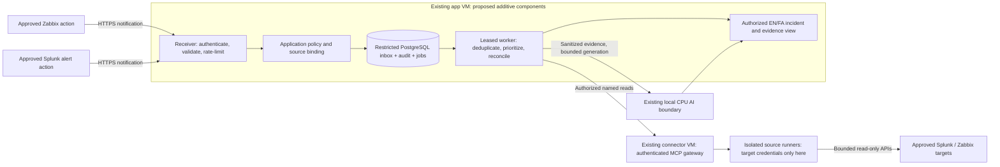

<div dir="rtl">

# پایش فعال با Webhookهای Splunk و Zabbix

[English](../en/ACTIVE_MONITORING_WEBHOOKS.md) · [فهرست](INDEX.md) · [نیازمندی و معیارهای پذیرش](../requirements/ACTIVE_MONITORING_WEBHOOK_SPEC.md)

نسخه: **۰٫۱، طراحی پیشنهادی و سند تحویل به تیم، ۳۱ اکتبر ۲۰۲۶**.

**این قابلیت هنوز پیاده‌سازی یا مستقر نشده است.** این سند مجوز دسترسی به سرور، تغییر فایروال،
تنظیم Splunk/Zabbix، مهاجرت پایگاه داده، تغییر مدل یا ارسال اعلان نیست. تمام مسیرها، پیام‌ها،
سقف‌ها و فرمان‌های زیر قرارداد پیشنهادی یا نمونهٔ پالایش‌شده‌اند، نه endpoint فعال.
هویت نسخه‌ها و نتایج پذیرش موجود در [manifest انتشار](../status/current-release.yaml) حفظ می‌شوند.

## ۱. هدف و مرز کار

هشدارهای مجاز زیرساخت بدون نیاز به سؤال اپراتور دریافت و ماندگار ثبت شوند؛ سپس شواهد تکمیلی
محدود جمع‌آوری و خلاصهٔ رخداد به فارسی یا انگلیسی همراه ممیزی تولید شود. خروجی باید روشن کند
چه اتفاقی، در چه زمان و برای کدام مقصد مجاز گزارش شده؛ چه چیزی تأیید شده، چه چیزی فرضیه است،
چه شاهدی نداریم و اپراتور چه بررسی ایمنی می‌تواند انجام دهد.

این قابلیت، **بررسی رخدادمحور نزدیک به زمان وقوع** است، نه تضمین پردازش بلادرنگ یا جایگزین SIEM.
Splunk محل ذخیره و جست‌وجوی لاگ می‌ماند و Zabbix سامانهٔ پایش. مشکل، رویداد و متریک Zabbix،
جریان تمام لاگ‌های سرورها نیست. خواندن محتوای log item تنها زمانی ممکن است که آن داده در منبع
وجود داشته باشد و عملیات مربوط جداگانه پشتیبانی و مجاز شده باشد.

خارج از دامنه: تکثیر انبوه لاگ، SPL آزاد، URL یا فرمان دلخواه، اصلاح خودکار، تأیید یا بستن مشکل
در منبع، تغییر alert، آموزش مدل با لاگ ورودی، انتخاب مدل تازه، VM جدید، وابستگی اجباری به
Redis/Kafka، SMTP، تماس صوتی یا AI ابری.

## ۲. وضعیت موجود و بخش پیشنهادی

| بخش | مبنای موجود مخزن | افزایش پیشنهادی |
|---|---|---|
| دریافت داده | شواهد محدود Zabbix/Linux با درخواست کاربر و MCP اصلی | اعلان از سمت منبع و تطبیق دوره‌ای محدود |
| Splunk | بدون adapter تأییدشده یا اتصال فعال | adapter فقط‌خواندنی سازگار با نسخه و اتصال مجاز منبع |
| ورودی | بدون گیرندهٔ Webhook پایش فعال | گیرندهٔ احرازشدهٔ مختص هر منبع |
| ماندگاری | PostgreSQL محدود برای بررسی و ممیزی موجود | inbox، سابقهٔ تحویل، کار پردازشی و نشانگر منبع |
| اجرا | مدل CPU محلی محدود؛ بدون worker عمومیِ پایش فعال | worker جداگانه با نظارت و سقف روشن |
| پنل | نماهای موجود بررسی و شاهد | فهرست رخداد محدود به مجوز و چرخهٔ عمر incident |
| اعلان | این طراحی هیچ کانال تازه‌ای را تأیید نمی‌کند | ابتدا پنل محلی؛ کانال دیگر با پذیرش جدا |

پیش از پیاده‌سازی، [معماری](ARCHITECTURE.md)، [مرز MCP](MCP.md)، [امنیت](SECURITY.md)،
[قرارداد آفلاین](OFFLINE_RUNTIME.md) و [داده/API](DATA_API.md) خوانده شوند. انتشار این سند،
شاخه‌های نامرتبطِ ادغام‌نشده را همگام یا وضعیت نسخهٔ زنده را بازتعریف نمی‌کند.

## ۳. معماری و محل قرارگیری

**طرح زیر مستقر نیست.** از VMهای موجود برنامه، AI و کانکتور استفاده می‌کنیم. رابط اپراتورها
روی VM برنامه می‌ماند. ورودی Webhook پشت reverse proxy داخلی HTTPS همان برنامه قرار می‌گیرد؛
listener محلی MCP را منتشر و VM مدل را به ورودی شبکه تبدیل نمی‌کنیم. مسیر تازه از منبع به
برنامه به تأیید مسئول شبکه نیاز دارد.



Webhook خبر رخداد را می‌آورد و MCP شاهد تکمیلی می‌خواند. سیاست برنامه، مجوز جمع‌آوری و نمایش
را تعیین می‌کند؛ پیام، annotation ابزار یا خروجی مدل مجوز نیست. توکن مقصد فقط نزد runner می‌ماند.
اگر MCP رسمی Splunk انتخاب شود، دسترسی آن از client/runner جدا و بازبینی‌شده خواهد بود؛ ابزارهای
آن مستقیم به مدل داده نمی‌شوند.

## ۴. تحویل نیازمندی شبکه

| آغازکننده | مقصد | کاربرد | قاعده |
|---|---|---|---|
| فرایند اعلان Zabbix مجاز | ورودی HTTPS برنامه | پیام مشکل، تغییر و بازیابی | مبدأ، مقصد و پورت دقیقِ تأییدشده |
| فرایند alert/search head مجاز Splunk | ورودی HTTPS برنامه | هشدارهای منتخب | هویت خروجی/NAT، مقصد و پورت دقیق |
| worker برنامه | MCP موجود در تونل محافظت‌شده | درخواست شاهد | حفظ احراز هویت، TLS و مرز اعتماد موجود |
| runner مجزای کانکتور | API مجاز HTTPS زبیکس | شاهد و تطبیق دوره‌ای | endpoint دقیق و اعتبارنامهٔ محدود منبع |
| runner مجزای Splunk | API مجاز search head یا MCP رسمی | جست‌وجوی تکمیلی | endpoint سازگار با نسخه؛ نه ورودی HEC |
| worker برنامه | مرز محافظت‌شدهٔ AI محلی | تحلیل شواهد | مسیر محلی، احراز هویت و پذیرش محدود موجود |

پورت HTTPS برابر 443 و پورت مدیریت Splunk برابر 8089 مثال‌های متداول‌اند، نه قاعدهٔ شبکهٔ
تأییدشده. FQDN، پورت واقعی، زنجیره گواهی، proxy/NAT و مسئول فایروال در پروندهٔ خصوصی ثبت شوند.
منبع Splunk Cloud شرط استقلال از WAN را ندارد؛ آن را منبع اختیاری وابسته به WAN معرفی کنید،
نه اینکه قرارداد کارکرد محلی NextOps را ضعیف کنید.

## ۵. اطلاعات موردنیاز از تیم‌ها

| مسئول | خروجی لازم |
|---|---|
| تیم Splunk | Enterprise/Cloud، نسخهٔ دقیق پلتفرم و appها، endpoint جست‌وجو، نسخه/endpoint اختیاری MCP رسمی، روش احراز هویت، رفتار retry، index/host/sourcetype مجاز، تعریف alert، شناسه رخداد، نگهداری و تأخیر ورود داده |
| تیم Zabbix | نسخهٔ دقیق، نگاشت منطقی منبع اصلی/دوم، host/group مجاز، نگاشت مشکل/تغییر/بازیابی، مسئول media/action، رفتار واقعی retry و دامنه API |
| مسئول امنیت و داده | هویت منبع، نگاشت سازمان/محیط، گیرندگان مجاز، پالایش اطلاعات شخصی/بانکی، نگهداری، اعتماد گواهی و تمدید/ابطال اعتبارنامه |
| تیم شبکه و PKI | مسیرهای جهت‌دار مجاز، هویت خروجی/NAT، DNS/زمان محلی، زنجیره گواهی معتبر، تمدید و اعتماد در حالت آفلاین |
| تیم NextOps | تنظیم خصوصی گیرنده، نسخه adapter، migration و نقش DB، registry منبع، سقف صف، سیاست، worker، پنل، آزمون و مسئول بازگشت |
| مسئول عملیات | پنجره تست، مسئول پیگیری، تأخیر/صف قابل‌قبول، تحمل قطعی، افق جبران داده و تأیید نهایی |

صرفاً برای خواندن شاهد، دسترسی root/admin به Splunk یا Zabbix نخواهید. اعتبارنامه از مسیر امن
مصوب تحویل شود؛ نه چت، ایمیل عادی، Git، تصویر یا URL درخواست. توکن جست‌وجوی API، توکن HEC
و توکن رمزنگاری‌شدهٔ MCP رسمی، سه اعتبارنامهٔ متفاوت‌اند.

## ۶. نمایهٔ منبع و احراز هویت

برای هر منبع، هویت و ارجاع secret جدا و بازبینی‌شده تعریف شود. نشست مرورگر، bearer سرویس MCP
یا توکن API مقصد را برای احراز پیام ورودی استفاده نکنید. سازمان، محیط، مقصدها و نوع رخداد مجاز
در تنظیم حفاظت‌شده تعیین شوند، نه با فیلد انتخابی فرستنده. مجوز هنگام شروع کار و نمایش نتیجه
دوباره بررسی شود.

گزینه‌های ممکن، mTLS یا فرستندهٔ احرازشده با درخواست امضاشده یا header حفاظت‌شده هستند.
برای **هر نسخهٔ نصب‌شده یک نمایهٔ دقیق** انتخاب و آزمایش شود. allowlist شبکه لایهٔ دفاعی مکمل است،
نه جایگزین احراز هویت منبع.

اگر نمایهٔ HMAC تأیید شد، headerهای شناسه کلید، زمان امضا، شناسه تحویل و امضا تعریف شوند.
زمان، شناسه تحویل و SHA-256 بایت‌های دقیق پیام با HMAC-SHA-256 امضا شوند. encoding بایت/امضا،
مقایسهٔ constant-time، رد کلید نامعتبر و حافظهٔ محدود مقابله با replay مشخص باشند. پنجرهٔ اولیهٔ
پیشنهادی 300 ثانیه است. retry مجازِ دیرهنگام باید امضای تازه داشته باشد یا نمایهٔ ضدبازپخشِ جدا
و بازبینی‌شده استفاده کند. قدیمی بودن زمان رخداد با قدیمی بودن امضای درخواست یکی نیست.
در تعویض کنترل‌شدهٔ کلید، هم‌پوشانی محدود کلید قبلی و تازه پشتیبانی شود.

**توقف سازگاری Splunk:** پشتیبانی مستند Webhook داخلی از URL و JSON، اثبات امکان header دلخواه،
HMAC یا گواهی client نیست. تیم منبع باید روش منتخب را نشان دهد. اگر کافی نبود، custom alert
action احرازشده، relay با احراز **مسیر بالادست آن**، یا polling فقط‌خواندنی بررسی شود. اضافه‌کردن
header توسط relay به پیام بالادستیِ بدون هویت، هویت منبع را ثابت نمی‌کند. برای عبور از تست،
secret داخل URL، غیرفعال‌کردن TLS یا اعتماد صرف به IP مجاز نیست.

نوع محتوا، تعداد بایت، عمق/نوع JSON، طول فیلد و نوع رخداد کنترل شود. redirect، فشرده‌سازی
غیرمنتظره و URL/فرمان خارج از schema رد شوند. متن host/event شاهد غیرقابل‌اعتماد است.
`results_link`، مسیر فایل یا callback دریافتی دنبال نشود؛ endpoint بررسی‌شده و شناسه رخداد مجاز
از registry حل شوند.

## ۷. قرارداد پیشنهادی HTTP

این مسیرها هنوز وجود ندارند:

```text
POST /api/v1/webhooks/zabbix/{integration_id}
POST /api/v1/webhooks/splunk/{integration_id}
```

`integration_id` شناسهٔ مبهم یک اتصال پیکربندی‌شده است، نه secret یا مجوز. هر مسیر adapter و
نمایهٔ احراز مختص خودش را دارد. API کاربران ضعیف و مسیر MCP به ورودی عمومی تبدیل نشود.
URL منابع تنها پس از استقرار و پذیرش endpoint/احراز هویت، در پروندهٔ تغییر خصوصی تنظیم شود.

| پاسخ | معنی پیشنهادی | رفتار فرستنده/اپراتور |
|---|---|---|
| `202` | inbox، ممیزی آغاز و کار ماندگار commit شده‌اند | تحلیل در انتظار است؛ مشکل تأیید یا تحلیل کامل نشده |
| `200` | تکرار تأییدشدهٔ تحویل قبلاً ثبت‌شده | رسید مبهم قبلی؛ بدون تحلیل دوم |
| `400` / `415` / `422` | قالب نامعتبر، نوع محتوای نامجاز یا فیلد نامعتبر | اصلاح تنظیم؛ بدون retry نامحدودِ پیام یکسان |
| `401` / `403` | هویت نامعتبر/غایب یا اتصال غیرمجاز | پیگیری از مسیر جدا؛ بدون هویت جایگزین |
| `404` | مسیر یا integration ناشناخته | پاسخ عمومی بدون افشای موجودی |
| `409` | هویت تحویل احرازشده با محتوای متعارض دوباره استفاده شده | نگهداری تعارض برای بررسی؛ بدون بازنویسی اصل |
| `413` | عبور از سقف پیام | کوچک‌کردن payload؛ نه قطع پیام و اعلام موفقیت |
| `429` | عبور از سقف نرخ، پذیرش یا backlog | retry محدود فقط در صورت پشتیبانی؛ بررسی واقعی `Retry-After` |
| `503` | نبود ممیزی، ذخیره‌سازی یا صف لازم | پیام commitنشده تأیید نشود؛ تحویل بعداً تطبیق داده شود |

پاسخ فقط رسید مبهم و شناسه correlation درخواست دارد؛ نه موجودی خصوصی، کلید، متن خام یا stack trace.
تحویل نامعتبر/ردشده با سقف مشخص و بدون دادهٔ حساس در ثبت امنیتی محلی می‌آید. اگر NextOps هیچ
چیزی نتواند ذخیره کند، لاگ سامانهٔ فرستنده همچنان برای پیگیری لازم است.
پذیرش کدهای موفقِ توافق‌شده، از جمله `202` و پاسخ تکرار، در نسخهٔ فرستنده اثبات شود؛ scriptی
که فقط `200` را موفق می‌داند پیش از فعال‌سازی باید اصلاح و بازبینی شود.

## ۸. پیام بومی و رخداد استاندارد داخلی

payload بومی مستند Splunk شامل اطلاعات جست‌وجو و نخستین ردیف نتیجه است؛ تمام لاگ‌های منطبق
را شامل نمی‌شود. ردیف‌های تکمیلی فقط با شناسه/الگوی جست‌وجوی مجاز و بازهٔ محدود دریافت شوند.
تیم منبع، تعریف rule و تفسیر آن را تأیید کند؛ شدت alert یا هم‌زمانی دو مشاهده، اثبات علت نیست.

در Zabbix، فیلدهای مشکل/تغییر/بازیابی صریح انتخاب و هم شناسهٔ مشکل اصلی و هم شناسهٔ بازیابی/
تغییر نگه‌داری شود. تست media type اثبات کارکرد action واقعی، برنامه/شدت گیرنده، مسیر بازیابی
یا رفتار retry نیست.

این قالب داخلی را adapter می‌سازد، نه فرستندهٔ بالادست:

```json
{
  "schema_version": "1.0",
  "delivery_id": "demo-delivery-001",
  "source_id": "demo-zabbix-primary",
  "source_event_id": "demo-problem-1001",
  "source_revision": "problem:1",
  "event_type": "problem",
  "target_id": "demo-app-01",
  "severity": "high",
  "title": "Illustrative service alert",
  "observed_at": "2026-10-31T10:00:00Z",
  "received_at": "2026-10-31T10:00:02Z",
  "correlation_id": "8bad8cfa-4ff9-4e2d-83cf-e9d23caec100",
  "provenance": "authenticated_source_notification",
  "evidence_status": "not_collected"
}
```

**فقط نمونه؛ نه داده زنده یا پیام بومی سازنده.** `source_id`، `target_id` و دامنه مجاز از تنظیم
استقرار حل می‌شوند؛ `received_at` و correlation متعلق به سرورند. زمان منبع، دریافت و جمع‌آوری
بعدی شاهد جدا باشند؛ ذخیره UTC و نمایش متناسب با زبان/منطقه زمانی انجام شود. schema نسخه‌دار،
فیلد امنیتی ناشناخته را رد کند. نگاشت مقصدِ غایب یا مبهم بدون فراخوانی MCP، ثبت خودکار موجودی
یا دسترسی بیشتر، در حالت قرنطینه قرار می‌گیرد.

پیش از فعال‌سازی منبع، schema پیاده‌سازی حداقل این محدودیت‌ها را تثبیت کند:

| فیلد | محدودیت پیشنهادی |
|---|---|
| `schema_version` | نسخهٔ دقیق پشتیبانی‌شده؛ رد نسخهٔ major ناشناخته |
| `delivery_id`، `source_event_id`، `source_revision` | رشتهٔ غیرخالی، حداکثر 128 نویسه برای هرکدام؛ نگاشت پایدار وابسته به نسخه |
| `source_id`، `target_id` | شناسه موجود registry حفاظت‌شده؛ نه endpoint ساخته‌شده توسط درخواست‌کننده |
| `event_type` | مجموعهٔ بستهٔ `problem`، `update`، `recovery` با نگاشت صریح adapter |
| `severity` | مجموعهٔ بستهٔ `unknown`، `info`، `warning`، `average`، `high`، `critical`؛ نگاشت منبع نسخه‌دار |
| `title` | حداکثر 512 نویسه؛ بدون تفسیر HTML یا محتوای اعتبارنامه |
| `observed_at`، `received_at` | timestamp دارای منطقه زمانی؛ زمان دریافت متعلق به سرور؛ زمان نامعتبر منبع صریح |
| `correlation_id` | UUID تولیدشده توسط سرور؛ نه هویت کاربر یا دامنهٔ مجوز |
| `provenance`، `evidence_status` | طبقه‌بندی اعلان/شاهد متعلق به سرور؛ نه ادعای سلامت تأییدشده از طرف فرستنده |

هش بایت خام برای امضا با هش رخداد استاندارد منبع برای حذف تکرار جدا باشد. زمان دریافت، رسید
و correlation تولیدشدهٔ سرور وارد هش دوم نشوند؛ وگرنه retry مجاز با تحویل نخست تعارض پیدا می‌کند.
افق نگهداری کلید تکرار با بیشترین سن retry/جبران هماهنگ شود؛ حذف کلید نباید رخداد منقضی را
بی‌صدا دوباره باز کند. شکست احراز نباید برای شناسه‌های دلخواه شمارندهٔ نامحدود بسازد.

## ۹. inbox ماندگار، ممیزی و worker

در PostgreSQL محدود موجود NextOps، migration افزوده و بازبینی‌شده استفاده شود؛ به‌صورت پیش‌فرض
VM پایگاه یا broker تازه نسازید. رکوردهای منطقی پیشنهادی شامل integration، تحویل/inbox، کار
تحلیل، checkpoint نشانگر، پیوند incident و ارجاع ممیزی‌اند؛ این‌ها نام جدول موجود نیستند.
index، یکتایی و grant نقش‌ها در migration واقعی تعریف شوند. نقش زمان اجرا اجازهٔ مدیریت DB
یا تغییر سابقهٔ ممیزی ندارد.

inbox ثبت‌شده باید restart آزمایش‌شدهٔ فرایند را تحمل کند، اما HA در خرابی میزبان یا backup مستقل
نیست. VMهای موجود یک دامنهٔ خرابی hypervisor/storage دارند. بازیابی آگاه از پایگاه همچنان معیار
جداگانهٔ پروژه با شاهد صریح است.

inbox معتبر، ممیزی الزامی آغاز و کار/outbox در یک transaction commit شوند؛ سپس موفقیت برگردد.
worker کار را با lease محدود تصاحب و تا زمان مالکیت heartbeat ثبت کند. وضعیت پایانی همراه هش
شاهد و ارجاع ممیزی ثبت شود. پس از restart کار commitشده بازیابی شود؛ انقضای lease نباید وقتی
فراخوانی قبلی هنوز اجرا می‌شود، مدل/کانکتور را دوباره اجرا کند. شناسهٔ مالکیت اجرا، drain و تطبیق
فراخوانی نامطمئن لازم‌اند؛ لغو، سقف پذیرش را زودتر از پایان واقعی فراخوانی آزاد نمی‌کند.

این طراحی پردازش قابل‌تکرار همراه حذف تکرار است، **نه تحویل یا اجرای exactly-once**. تعداد
تلاش و زمان تلاش بعدی ذخیره شوند. تنها خطای گذرای طبقه‌بندی‌شده با backoff و jitter محدود
تکرار شود؛ خطای هویت/سیاست/schema برای اقدام اپراتور نگه داشته شود. پس از تعداد تلاش محدود،
وضعیت dead-letter/held قابل‌بررسی باقی بماند. نبود ممیزی الزامی، نمایش نتیجهٔ موفق را متوقف می‌کند.

## ۱۰. هویت، حذف تکرار و چرخهٔ رخداد

سه هویت متفاوت داریم:

- هویت تحویل: retry یا بازپخش همان پیام؛ حذف تکرار در دامنهٔ همان integration.
- هویت رخداد/بازبینی منبع: اعلان دربارهٔ یک مشکل یا وضعیت نتیجهٔ جست‌وجو.
- هویت incident/هم‌بستگی: گروه‌بندی مشاهدات مجاز برای اپراتور.

در کلید حذف تکرار، سازمان، محیط و منبع لحاظ شوند. revision می‌تواند شناسهٔ بالادست یا اثرانگشت
تعریف‌شده در adapter باشد؛ عنوان یا host به‌تنهایی کلید حذف تکرار نیست. استفادهٔ دوباره از
delivery ID با هش payload احرازشدهٔ متفاوت، تعارض/رخداد امنیتی است، نه تکرار پذیرفته‌شده.
SID اسپلانک اجرای جست‌وجو را مشخص می‌کند، نه الزاماً یک incident ادامه‌دار؛ کلید پایدار نتیجه
جدا تعریف شود. نسخهٔ adapter و سیاست نیز نگه‌داری شود.

وضعیت‌های پیشنهادی: `received`، `validated`، `queued`، `collecting`، `analyzing`، `completed`،
`partial`، `held`، `failed` و `resolved`. وضعیت تحویل، تحلیل و مشکل منبع جدا باشند. اعلان بازیابی
می‌تواند پیش از پایان تحلیل برسد. پیام مشکلِ قدیمی نباید آن را بی‌صدا دوباره باز کند. sequence یا
revision منبع در صورت وجود ترجیح دارد؛ ابهام ساعت/ترتیب آشکار بماند. بازیابیِ بدون مشکل شناخته‌شده
ذخیره و تطبیق داده می‌شود، نه اینکه حذف شود.

## ۱۱. تطبیق دوره‌ای و شکاف داده

Webhook ممکن است گم، تکراری یا دیر دریافت شود. retry واقعی به نسخه و تنظیم فرستنده وابسته است؛
فرض نکنید Splunk/Zabbix بی‌نهایت تکرار می‌کنند یا همهٔ کدهای HTTP را یکسان تفسیر می‌کنند.
تیم منبع timeout، تعداد تلاش، فاصله retry و مهلت نگهداری را با مشاهده ثبت کند.

برای هر منبع یک نشانگر مجاز و مستقلِ تطبیق نگه دارید. فاصلهٔ اولیهٔ پیشنهادی 60 ثانیه است و
تأیید تیم منبع را می‌خواهد. بازهٔ محدود هم‌پوشان، شناسهٔ رخداد برای شکستن تساوی و حذف تکرار برای
دادهٔ دیرایندکس‌شده و اختلاف ساعت لازم‌اند. نشانگر فقط پس از commit صفحهٔ دریافت‌شده جلو برود.
پاسخ ناقص، timeout یا صفحهٔ بریده نباید نشانگر را از دادهٔ واقعاً ثبت‌شده جلوتر ببرد. انقضای
نگهداری منبع یا نتیجهٔ جست‌وجوی غیرقابل‌دسترسی، شکاف قابل‌نمایش است؛ نه ادعای بازیابی همهٔ رخدادها.
وضعیت بازیابی نیز تطبیق داده شود، نه فقط مشکل‌های جدید.

## ۱۲. جمع‌آوری شاهد و رفتار AI

کار پس‌زمینه به principal محدود integration و subscription مصوب متصل شود، نه نشست تعاملی
ساختگی. سازمان، محیط، مقصد، عملیات و index پیش از دریافت مجاز شوند. پس از ابطال دسترسی و
بلافاصله پیش از انتشار، مجوز دوباره کنترل شود. حتی اگر service شاهد را جمع کرده، هر اپراتور
فقط incident و شاهدی را ببیند که مجوز جاری خودش اجازه می‌دهد.

عملیات نام‌دار Zabbix و الگوی جست‌وجو/saved search سازگار با نسخهٔ Splunk، با پارامتر دارای نوع،
بازه زمانی، index/host مجاز و سقف خروجی استفاده شوند. SPL آزاد مدل، index wildcard، فرمان
تغییردهنده، تأیید مشکل یا تغییر alert ممنوع است. ایجاد search job بومی ممکن است لازمهٔ خواندن
باشد؛ چرخهٔ آن فقط به jobهای خود integration محدود شود و مجوز مدیریت عمومی منبع ندهد.

secret و فیلد شخصی/بانکی ممنوع پیش از ذخیره و ورود به مدل پالایش شوند. نگهداری خام در صورت نیاز،
طراحی جدا برای مجوز، رمزنگاری و انقضا می‌خواهد و با این پیشنهاد فعال نمی‌شود. هش برای صحت و
منشأ است؛ جایگزین ناشناس‌سازی یا حذف نیست. مدل فقط شواهد پالایش‌شده می‌گیرد، نه توکن یا تنظیم
پنهان کانکتور.

مدل CPU محلی باید «هشدار گزارش‌شده»، «مشاهدهٔ مستقلاً دریافت‌شده»، «فرضیه» و «بررسی پیشنهادی»
را جدا کند؛ منبع/زمان/دامنه واقعی را بیاورد و شاهد ناقص/قدیمی/غایب را مشخص کند. منبع خراب بی‌صدا
با منبع دیگری جایگزین نشود. شکست تولید، هشدار را پاک نمی‌کند؛ واقعیت ثبت‌شده با وضعیت
`analysis unavailable` نمایش داده شود، نه جواب AI ساختگی. پرسش‌وپاسخ عمومی با سالم بودن
وابستگی‌های خودش باید قابل‌استفاده بماند.

## ۱۳. سقف‌های اولیهٔ پیشنهادی؛ نه اندازه‌گیری واقعی

| کنترل | نامزد اولیه | الزام پذیرش |
|---|---|---|
| حجم ورودی | 64 KiB؛ بدون بدنهٔ فشرده | کنترل هنگام خواندن، پیش از تخصیص نامحدود |
| نرخ ورودی | 30 تحویل در دقیقه برای هر integration؛ burst برابر 10 | شمارندهٔ محدود مشترک و آزمون معنای دقیق تجمیع |
| backlog ناتمام | 1,000 رخداد کلی؛ 100 برای هر integration | پذیرش اتمی؛ رد پیش از commit در صورت پر بودن |
| متن استاندارد نگهداری‌شده | عنوان 512 نویسه؛ پیام 4,096 نویسه | وضعیت اندازه/ناقص صریح؛ بدون ادعای لاگ کاملِ بریده |
| شاهد Splunk | 15 دقیقه اخیر؛ حداکثر 100 ردیف / 128 KiB | نتیجهٔ محدود کامل یا برچسب truncation؛ بدون export نامحدود |
| تطبیق | فاصله 60 ثانیه؛ هم‌پوشانی 5 دقیقه؛ افق عادی 24 ساعت | تنظیم در دامنه مجاز؛ جبران قدیمی‌تر با دامنهٔ صریح |
| retry | حداکثر 5 تلاش؛ backoff نمایی تا 5 دقیقه | تفکیک retry گیرنده از retry تحویل فرستنده |
| نگهداری رخداد | 30 روز رخداد پالایش‌شده؛ 7 روز جزئیات خطای held | تأیید مسئول داده؛ آزمون سهمیه و purge |
| زمان منبع | توضیح اختلاف ساعت؛ پنجره HMAC برابر 300 ثانیه در صورت استفاده | سن رخداد و سن امضای تحویل جدا بررسی شوند |
| پذیرش AI | حفظ سیاست مشترک موجود یک فعال / دو منتظر | بدون صف نامحدود مستقل تولید پس‌زمینه |
| بودجه مدل موجود | حفظ سقف مصوب CPU/RAM/context/time | بدون resize خودکار VM، افزایش timeout یا runtime کامل دوم |

backlog ماندگار رخداد، صف حافظهٔ مدل نیست. dispatcher با کار تعاملی منصفانه و قطعی داوری کند؛
ظرفیت کار کاربر محفوظ بماند و starvation رخ ندهد. قواعد نسخه‌دار باشند. برای هر خط لاگ یا هر
تکرار بدون تغییر، مدل فراخوانی نشود؛ ابتدا تجمیع و سپس تحلیلِ ادغام‌شده/به‌تعویق‌افتاده با برچسب
روشن، بدون ازبین‌رفتن رکوردها انجام شود.

## ۱۴. تجربهٔ اپراتور و اعلان محلی

فهرست پیشنهادی رخداد، مجوز جاری، فارسی/انگلیسی، RTL/LTR، فیلتر شدت/منبع/مقصد، سابقهٔ زمانی،
وضعیت دریافت/تحلیل، شمارش تکرار و تازگی منبع را دارد. نمای incident پیام اولیه را از شاهد
تکمیلی و فرضیهٔ AI جدا می‌کند. نبود شاهد، دادهٔ قدیمی، شکاف، قطعی AI و بازیابی بدون اتکا به
رنگ تنها قابل‌فهم باشند. تأیید مشاهده توسط اپراتور در پنل، مشکل Zabbix را تأیید یا بسته نمی‌کند.

خروجی نخست پنل محلی است و SMTP لازم نیست. صدا، پیامک، تماس PBX و کانال دیگر به پذیرش جدا برای
endpoint، گیرنده، حریم خصوصی، retry، دریافت تأیید و escalation نیاز دارند و اینجا فعال نمی‌شوند.
شکست اعلان نباید موفقیت بی‌صدا شود. شدت، گروه‌بندی و cooldown بازبینی‌شده از طوفان هشدار
جلوگیری کنند؛ شکست دریافت پشت متن AI پنهان نشود.

## ۱۵. خطا و رفتار آفلاین

| خطا | رفتار لازم |
|---|---|
| قطع PostgreSQL یا ممیزی الزامی | بدون موفقیت کاذب؛ خطای قابل‌تکرار و اتکا به retry مشاهده‌شده/تطبیق |
| restart گیرنده پس از ثبت رسید | ادامهٔ کار ثبت‌شده بدون تحلیل آشکار دوم برای همان revision |
| قطع Splunk/Zabbix | حفظ رخداد؛ شاهد unavailable/partial؛ retry محدود و تازگی آشکار |
| قطعی/اشباع AI | حفظ واقعیت منبع و وضعیت صف؛ بدون پاسخ ساختگی یا مختل‌کردن ورود/چت |
| عبور از نرخ، backlog یا سهمیه دیسک | مصرف محدود، هشدار عملیات و خطای پذیرش صادقانه |
| قطع اینترنت با LAN مجاز سالم | ورودی، هویت، DB، MCP، تولید CPU و UI محلی پس از آماده‌سازی کار کنند |
| قطع LAN منبع | نمایش stale/unavailable و ادامهٔ تطبیق محدود مجاز پس از وصل |
| بازیابی تکراری، دیررس یا بی‌ترتیب | حفظ سابقه و حذف تکرار/تطبیق قطعی چرخهٔ رخداد |
| انقضا/ابطال اعتبارنامه یا گواهی | توقف امن integration مربوط؛ بدون دورزدن TLS یا secret جایگزین |

دانلود زمان اجرا، وابستگی به DNS عمومی، embedding خارجی، تولید ابری یا هویت فقط-WAN ممنوع است.
Splunk ابری محدودیت WAN صریح دارد. offline مرورگر یا timeout مصنوعی اثبات عملکرد سرور با WAN
قطع‌شده نیست. cold start و تست واقعی مجاز LAN/WAN معیارهای جدا هستند؛ نتیجهٔ تاریخی خودکار
به این قابلیت منتقل نمی‌شود.

## ۱۶. مراحل پیکربندی تیم‌های منبع

**آماده‌سازی مشترک:** endpoint و اعتماد خصوصی ردوبدل، دامنهٔ داده و هویت منبع تصویب، احراز هویت
پذیرفته، ممیزی منبع فعال، سقف تحویل توافق و تست کوچک قابل‌بازگشت زمان‌بندی شود. تا استقرار و
آزمون گیرنده، URL پیشنهادی را در منبع فعال نکنید.

**تیم Zabbix:** متناسب با نسخه، نمایه webhook و گیرندهٔ اعلان محدود بسازید؛ شدت/ساعات مجاز و
actionهای مشکل، تغییر و بازیابی را تنظیم کنید. شناسهٔ پایدار مشکل/بازیابی را نگاشت و TLS/احراز
را ثابت کنید؛ تلاش‌های واقعی تحویل را بسنجید. action واقعی مجاز و بازیابی آن تست شوند، نه فقط
دکمهٔ Test در media type. دریافت اعلان به توکن admin زبیکس برای NextOps نیاز ندارد.

**تیم Splunk:** saved search/alert مصوب با index، مقصد و بازهٔ صریح انتخاب شود؛ schedule، حالت
trigger، کلید نتیجه و throttling ثبت شوند. در نسخه‌های لازم، مقصد به allowlist Webhook اضافه
شود. payload واقعی و پشتیبانی احراز نشان داده شود؛ اگر کافی نبود، custom action/مسیر احرازشده
بازبینی یا polling انتخاب شود. محدودیت نخستین ردیف و دسترسی جداگانهٔ محدود جست‌وجو برای شاهد
تکمیلی روشن باشد. انقضای نتیجه پیش از دریافت NextOps بررسی شود. HEC token، اعتبارنامهٔ جست‌وجو نیست.

**تیم NextOps:** بعد از مجوز مستقل پیاده‌سازی، گیرنده با تنظیم محافظت‌شده، نقش/migration محدود DB
و integrationهای غیرفعال مستقر شود. تست منفی هویت/اندازه/نرخ گذرانده و فقط یک منبع و یک مقصد
مجاز فعال شود. شناسهٔ رسید، ممیزی، رخداد، کار و شاهد ثبت؛ تحلیل تازهٔ فارسی و انگلیسی کنترل شود.
retry، تکرار، بازیابی و شکاف پیش از گسترش دامنه ثابت شوند. برای هر دامنهٔ تازه تأیید مسئول داده،
امنیت و عملیات گرفته شود.

## ۱۷. نمونهٔ آزمون برای آزمایشگاه جداگانهٔ آینده

این مثال روی برنامهٔ فعلی کار نمی‌کند. فقط گیرندهٔ آزمایشگاهی مجاز و fixture پالایش‌شده استفاده
شود. مالک اعتبارنامه، فایل header را با مجوز `0600` آماده می‌کند؛ محتوایش چاپ و secret وارد
آرگومان/تاریخچه نشود. مثال، نمایهٔ header پذیرفته‌شده را فرض می‌کند؛ HMAC/mTLS به سازندهٔ درخواست
بازبینی‌شده و امضای تازهٔ خود نیاز دارند.

```bash
# Illustrative future lab inputs: not real production addresses or credentials.
export NEXTOPS_WEBHOOK_TEST_URL='https://nextops-lab.example/api/v1/webhooks/zabbix/demo'
curl --noproxy '*' --proto '=https' --tlsv1.2 \
  --cacert /run/nextops-webhook-test/ca.pem \
  --header @/run/nextops-webhook-test/protected-headers.txt \
  --header 'Content-Type: application/json' \
  --data-binary @/run/nextops-webhook-test/sanitized-native-event.json \
  --connect-timeout 3 --max-time 5 \
  "$NEXTOPS_WEBHOOK_TEST_URL"
```

از `-k`، دنبال‌کردن redirect، ثبت secret و سایت عمومی تست Webhook برای دادهٔ شرکت استفاده نکنید.
`202` اولیه، `200` تکرار commitشده، رد تحویل تکراری ناسازگار، هویت نامعتبر، پیام بزرگ و نبود
ممیزی/ذخیره‌سازی تست شوند. retry مجاز HMAC با امضای تازه انجام شود، نه امضای منقضی. fixture بومی
واقعیِ پالایش‌شدهٔ هر adapter را بفرستید، نه JSON استاندارد داخلی.

## ۱۸. پذیرش، سنجه و شاهد

شناسه‌های کامل پذیرش و ماتریس پیشنهادی تست در [مشخصات محدود](../requirements/ACTIVE_MONITORING_WEBHOOK_SPEC.md)
هستند. تمام معیارهای زمان اجرای این قابلیت فعلاً `not_run` هستند؛ اعتبارسنجی مستندات پذیرش
Webhook محسوب نمی‌شود.

تأخیر اعلان منبع، ACK دریافت، انتظار صف، خواندن MCP، زمان نخستین توکن، مدت تولید و کل تحلیل
جدا ثبت شوند. تعداد نمونه، p50/p95/max، خطا، retry، رد/held/حذف، سن قدیمی‌ترین backlog، مصرف
CPU/RAM/دیسک، فراخوانی بومیِ هنوز در حال drain و تازگی منبع گزارش شود. تأخیر رسید با زمان تشخیص
incident یکی نیست. هدف عددی تأخیر پیش از پذیرش به توافق مسئول و اندازه‌گیری بار واقعی نیاز دارد.

شاهد خصوصی خارج Git نگه‌داری شود: نسخهٔ دقیق release/schema adapter/سیاست، دامنهٔ مجاز، correlation
درخواست/رسید، شناسهٔ رخداد/revision و job، هش شاهد استاندارد، ارجاع DB/ممیزی، زمان، فرمان، شکست،
بازپخش/بازگشت و بازبینی اپراتور. فقط خلاصهٔ پالایش‌شده منتشر شود. از simulator، ادعای آمادگی
production، تحویل بدون اتلاف یا پوشش کامل نسازید.

## ۱۹. ترتیب پیاده‌سازی و بازگشت

1. تصمیم‌های باز، پروندهٔ منابع و تهدیدها تصویب شوند؛ تغییر پایدار در محل استقرار، ماندگاری یا
   احراز هویت برخلاف معماری موجود به ADR نیاز دارد.
2. adapterهای بومی دارای نوع، fixture و schema بسته بدون دسترسی شبکه پیاده شوند.
3. migration بازبینی‌شدهٔ inbox/audit/outbox و نقش محدود افزوده و با PostgreSQL واقعیِ جدا تست شوند.
4. ورودی محدود احرازشده، worker دارای lease و تطبیق پشت feature flag غیرفعال اضافه شوند.
5. شاهد فقط‌خواندنی Splunk پذیرفته و عملیات تأییدشدهٔ موجود Zabbix/MCP دوباره استفاده شوند.
6. UI مجاز incident، اعلان محلی و زمان‌بندی مشترک مدل اضافه و regression فارسی/انگلیسی اجرا شود.
7. خطا/restart/آفلاین/بار/حریم خصوصی/بازگشت در lab پذیرفته؛ سپس pilot زندهٔ تک‌منبع درخواست شود.
8. گسترش تنها با شاهد پذیرش و تأیید دامنه؛ استقرار خودکار CI نداریم.

بازگشت: فقط integration/مسیر جدید غیرفعال، action فرستنده هماهنگ، پذیرش متوقف و کار دارای مالک
drain یا held شود. inbox، نشانگر، ممیزی و شاهد حفظ شوند؛ برای تمیز نشان‌دادن نتیجه، داده یا رکورد
شکست حذف نشود. schema قدیمی سازگار بماند؛ فقط اعتبارنامهٔ جدید توسط مالک ابطال/تعویض شود؛
artifact دقیق قبلی برنامه/worker بازگردد و ورود، چت و خواندن Zabbix قبلی بررسی شود. job یا فراخوانی
نامطمئن قبل از تکرار تطبیق داده شود. تحویل‌های نگهداری‌شده برای بازپخش مجاز بعدی مستند شوند.
snapshot مهمان اثبات بازیابی پایگاه نیست؛ backup/restore آگاه از DB و معیارهای باز بازیابی پروژه
جدا باقی می‌مانند.

## ۲۰. قالب تحویل خصوصی و تأیید

این **قالب خالی** را به پروندهٔ خصوصی مصوب ببرید؛ مقادیرش را در issue عمومی ننویسید:

```text
change_id / document_version:
source_type / exact_version / adapter_version:
owner / technical_contact / test_window / rollback_owner:
organization_environment / allowed_targets / indexes_groups / event_classes:
receiver_fqdn_port_path / sender_egress_identity / approved_network_flow:
ingress_auth_profile / secret_reference / rotation_revocation_owner:
tls_ca_reference / certificate_expiry / local_time_dependency:
enrichment_endpoint_reference / credential_reference / read_permissions:
event_id_revision_mapping / recovery_mapping / delivery_retry_observations:
schedule_throttle / retention_indexing_delay / reconciliation_horizon:
rate_body_backlog_caps / latency_objectives / privacy_and_retention_approval:
qualification_evidence / open_gates / rollback_result / signatories:
```

تا تعیین endpoint/هویت، دامنهٔ منبع/داده، سازگاری نسخه، ممیزی پایدار، سقف محدود، جداسازی secret
و مسئول بازگشت، pilot فعال نشود. وضعیت `configured`، `lab_verified` یا `live_pilot_qualified`
فقط با شاهد همان سطح ثبت شود؛ `not_configured` یا `unavailable` هرگز سبز/متصل نمایش داده نشود.

## ۲۱. منابع و نحوهٔ تفسیر

بررسی منابع در ۳۱ اکتبر ۲۰۲۶ انجام شده؛ رفتار باید با نسخهٔ نصب‌شدهٔ واقعی تیم تطبیق داده شود:

- [Webhook در Zabbix 7.0](https://www.zabbix.com/documentation/7.0/en/manual/config/notifications/media/webhook)
- [گزینه‌ها و تست Media در Zabbix 7.0](https://www.zabbix.com/documentation/7.0/en/manual/config/notifications/media)
- [Webhook Alert Action در Splunk Enterprise](https://help.splunk.com/en/splunk-enterprise/alert-and-respond/alerting-manual/9.2/configure-alert-actions/use-a-webhook-alert-action)
- [توکن احراز هویت API اسپلانک](https://help.splunk.com/en/splunk-enterprise/administer/manage-users-and-security/9.4/authenticate-into-the-splunk-platform-with-tokens/use-authentication-tokens)
- [قرارداد اتصال MCP رسمی Splunk](https://help.splunk.com/en/splunk-enterprise/mcp-server-for-splunk-platform/2.1/set-up-and-connect-to-splunk-mcp-server/connecting-to-the-mcp-server-and-settings)

این منابع سازوکار سازنده را توضیح می‌دهند، نه پیاده‌سازی NextOps یا مجوز اجرا را.
[تصمیم پذیرفته‌شدهٔ MCP](../adr/0010-source-scoped-zabbix-mcp.md)، سوابق انتشار، الزام CPU-only/
آفلاین و منشأ الزامی شاهد در تمام مراحل حفظ شوند.

</div>
